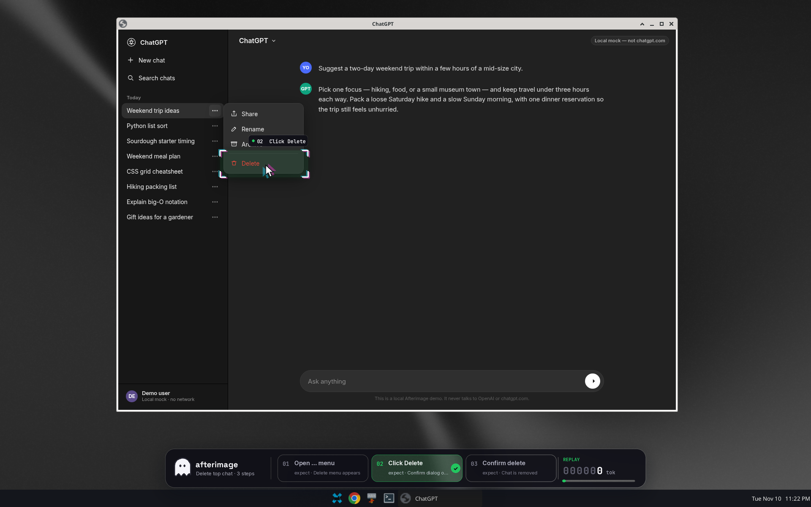
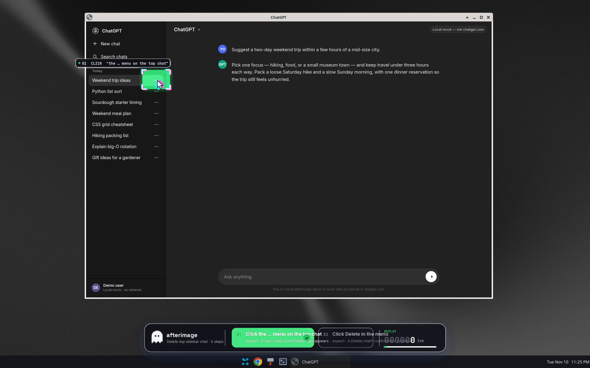
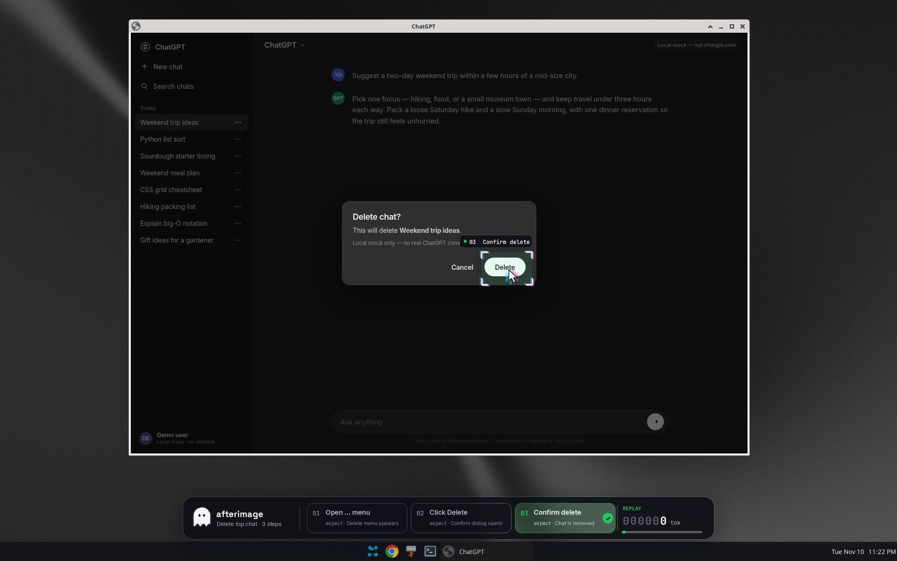
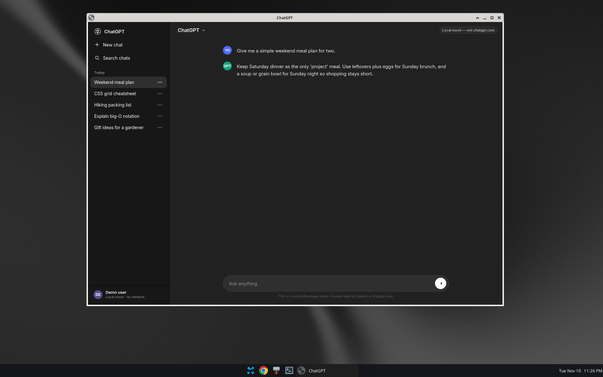
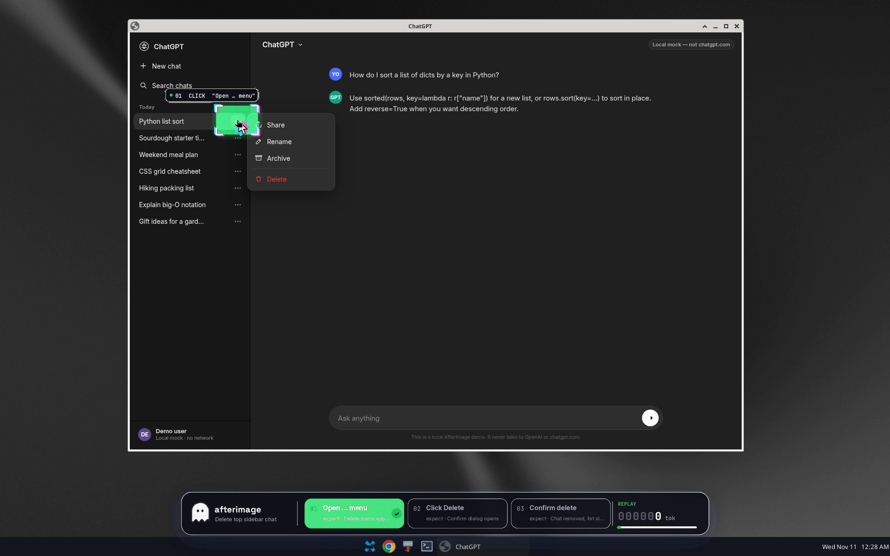
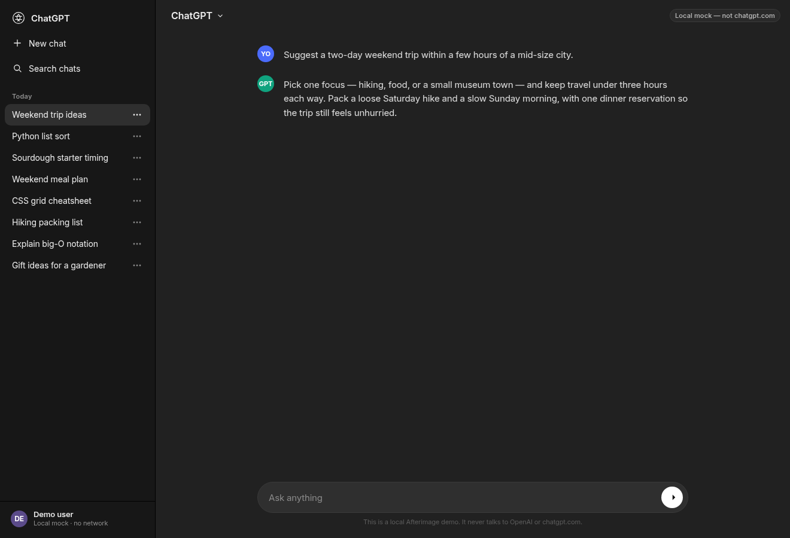

# Afterimage

**Teach a desktop click-flow to Hermes once. Watch it rehearse with a see-through HUD. Then replay it at zero tokens.**

Hermes `computer_use` is powerful but every click costs a screenshot and a model call. If you do the same thing twice, you pay twice. Afterimage records the flow the first time the AI figures it out, keeps an expected screenshot for every step, and afterwards replays the clicks at fixed positions without calling the model at all. Before you trust a replay you can rehearse it: a click-through overlay shows the next click as an "afterimage" on the real screen, checks the live pixels against the recording, and turns green when they match.

Standalone Hermes plugin, Linux/X11 first. It does not patch Hermes core.



## The loop

1. **Record (AI, once).** The agent drives the UI with `computer_use`. `afterimage_locate` grounds each control through `ctx.llm`. Each click, its window-relative coordinate and an expected screenshot are saved into a named flow.
2. **Rehearse (visible, 0 tokens).** `afterimage_rehearse` draws each step on the Double Exposure HUD — viewfinder brackets, a cyan/magenta afterimage cursor, a dark-glass step dock and a token odometer. If the live screenshot matches the recording the step turns green and is clicked. No model call.
3. **Replay (full speed, 0 tokens).** `afterimage_replay` runs the same fixed-position clicks, optionally `times=N`. If a step no longer matches it stops instead of clicking blind.

| Rehearse: step 1 matches | Rehearse: step 3 confirm | After a zero-token replay |
|---|---|---|
|  |  |  |



All screenshots are real Hermes `--yolo` sessions on a **local mock** of a ChatGPT-style sidebar (see below), not chatgpt.com.

## Demo: deleting chats from a sidebar (local mock)

ChatGPT has no "delete all" button; deleting one chat is three clicks (⋯ → Delete → confirm). After a row is deleted the list slides up, so the same three screen positions delete the next chat. That makes a clean record-once, replay-many demo.

The demo page is `demo/chatgpt-sidebar/index.html`: an offline HTML file with fake chat titles and a visible **"Local mock — not chatgpt.com"** badge. It makes no network requests and deletes nothing real. It is not affiliated with OpenAI.

```bash
demo/open-mock.sh                 # opens a Chrome --app window titled "ChatGPT"; prints pid and window_id
# put the printed pid/window_id into demo/prompts/01-record.txt (__PID__ / __WID__)
hermes chat --oneshot --yolo -t computer_use,afterimage -q "$(cat demo/prompts/01-record.txt)"
demo/open-mock.sh                 # reload the list
hermes chat --oneshot --yolo -t computer_use,afterimage -q "$(cat demo/prompts/02-rehearse.txt)"
hermes chat --oneshot --yolo -t computer_use,afterimage -q "$(cat demo/prompts/03-replay.txt)"
```

`--yolo` is a session choice made by the person running the demo; the plugin never turns it on. Without it Hermes asks you to approve each click as usual.



## Install

```bash
hermes plugins install https://github.com/LucianaiB2004/hermes-afterimage
hermes plugins enable afterimage
hermes -t computer_use,afterimage chat
```

Optional, to ground clicks with a dedicated vision model (`llm.model_override` capability):

```yaml
plugins:
  entries:
    afterimage:
      llm:
        allow_model_override: true
        allowed_models: [qwen3-vl-plus]
```

If you do not grant it, locate uses the session model.

## Tools

| Tool | Purpose |
|---|---|
| `afterimage_locate` | Ground a control in the latest `computer_use` capture via `ctx.llm` |
| `afterimage_begin_record` / `afterimage_end_record` | Record the next `computer_use` actions into a named flow |
| `afterimage_list` | List saved flows |
| `afterimage_rehearse` | Visible step-by-step rehearsal on the HUD (green = match, red = mismatch) |
| `afterimage_replay` | Zero-token replay; `times=N` repeats the fixed-position sequence; stops on a mismatch |

Hooks: `post_tool_call` (records `computer_use` actions and remembers the latest capture), `pre_llm_call`, `post_api_request` / `post_auxiliary_call` (token odometer), `on_session_finalize` (tears down the HUD). Slash commands: `/afterimage record|stop|list|rehearse|replay`.

Flows live under the plugin data directory (`plugin_data_dir("afterimage")/flows/`), not in the install tree.

Tip for Linux: always pass `pid` and `window_id` (or a `window_title`) with `delivery_mode=foreground`. Chrome `--app` windows do not show up under their title in `list_apps`; the plugin re-resolves pid/window from the live title on replay.

## Requirements

- Hermes Agent ≥ 0.23 with the `computer_use` toolset (`cua-driver`) on an X11 display.
- A compositor (e.g. picom) for per-pixel alpha. Without one the HUD still draws but will not blend.
- A vision-capable model for the first recording (tested with Qwen3-VL via DashScope).
- Python deps (installed by Hermes): Pillow, python-xlib, mss. Set `AFTERIMAGE_PYTHON` to use a different interpreter for the overlay sidecar.

## Limitations (honest list)

- **Fixed positions are brittle.** If the window moves, resizes or the layout changes, replay clicks would land in the wrong place. That is why rehearsal compares pixels first and replay stops on a mismatch.
- **Repair is experimental.** `afterimage_rehearse repair=true` can hand a mismatched step to the model and write the new coordinate back, but it is not reliable yet (a re-opened window can be flagged as drift, and grounding can pick the wrong button). It is off by default for replay and is not part of the demo.
- Linux/X11 only for now. No Wayland, macOS or Windows overlay yet.

## How it is different

| | Afterimage | hud-teach | workflow-record |
|---|---|---|---|
| Who acts | The agent records once, then replays without a model | You follow on-screen marks | Browser tools |
| Surface | Desktop `computer_use`, Linux/X11 | macOS lesson overlay | A browser tab over CDP |
| Visible check before replay | Yes: live vs. recorded pixels, green/red HUD | n/a | No |
| Tokens on repeat | 0 for matching steps | Session model | Model writes a skill |

## Trust and safety (catalog rule 13 disclosures)

- **Credentials:** none read directly. Model calls go through `ctx.llm`. The plugin never reads `.env`, `auth.json` or any API key.
- **Clicks** go through `ctx.dispatch_tool("computer_use", …)`, so Hermes approvals apply.
- **Background process:** a short-lived, click-through ARGB overlay sidecar (`overlay_server.py`) on the local X display, controlled over a Unix socket in `/tmp`, torn down on session finalize.
- **Data written:** flow recordings (actions + PNG screenshots) under the plugin data dir; overlay log at `/tmp/afterimage-overlay.log`.
- **Network:** none of its own. No telemetry.

## Development

```bash
python -m unittest discover -s tests -v
hermes plugins validate . --install-deps
```

## License

MIT (see `LICENSE`). The demo font Inter is SIL OFL 1.1.
